<picture>
  <source media="(prefers-color-scheme: dark)" srcset="assets/hero-dark.svg">
  <source media="(prefers-color-scheme: light)" srcset="assets/hero-light.svg">
  
</picture>

I build full-stack products from the backend out: APIs, data models and the services behind them, with LLMs wired in where they do real work.

- **Stack:** Python · FastAPI · SQLAlchemy · Pydantic
- **Building:** [inventory_backend](https://github.com/amirzaliyev/inventory_backend), stock and sales tracking for manufacturers

<picture>
  <source media="(prefers-color-scheme: dark)" srcset="https://raw.githubusercontent.com/amirzaliyev/amirzaliyev/output/pulse-dark.svg">
  <source media="(prefers-color-scheme: light)" srcset="https://raw.githubusercontent.com/amirzaliyev/amirzaliyev/output/pulse-light.svg">
  
</picture>
